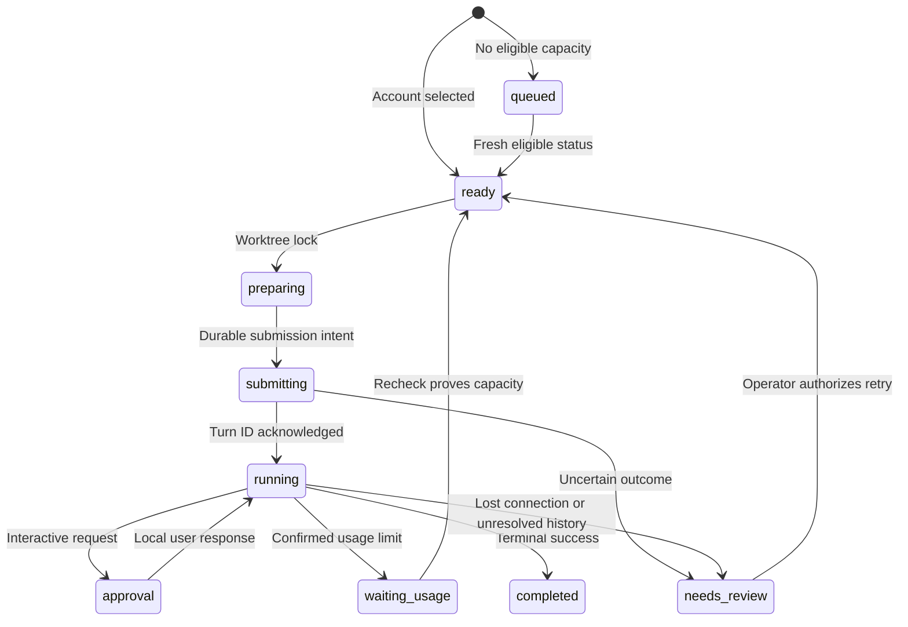

# Architecture

The foreground worker is a single scheduling loop. It pumps active-turn events, performs due status rechecks even while the execution slot is occupied, then dispatches a ready job when free. No loop iteration generates a model prompt merely to keep the process alive.

## Modules

| Module | Responsibility |
|---|---|
| `cli.py` | Commands, official login adapter, sanitized status, doctor/schema checks |
| `core.py` | Eligibility/selection, dispatch, wake-ups, approvals, cancellation, reconciliation |
| `usage.py` | Allowlisted usage storage, sparse merges, model applicability, headroom checks |
| `protocol.py` | JSON-lines app-server RPC, isolated environment, event transport |
| `store.py` | SQLite schema/transactions, redaction, kernel-owned locks |
| `backend.py` | Official backend and durable deterministic fake backend |

## State and isolation

SQLite stores accounts, per-bucket/window usage and observations, jobs with wake times, submission attempts, approval requests/responses, and events. Secrets remain in Codex-owned credential files under individual profile homes. The default login is neither imported nor signed out.

Each task is pinned to its selected account and thread. Primary, secondary, global, model-specific, and unmapped conservative buckets are checked. Sparse notifications preserve absent snapshot fields; explicit full reads are used before recovery. Reset times are estimates for rechecking, not permission to resume.

The worker commits a submission intent before `turn/start`, then records the returned turn ID. The client correlation ID is not assumed to be an idempotency guarantee. On restart it reads persisted Codex history and reconciles terminal results; ambiguous history requires review instead of replay.

A kernel lock coordinates one worker per scheduler state directory. Canonical Git worktree locks prevent another local scheduler home from writing the same worktree concurrently. Durable review barriers live within their state directory. Neither filesystem locks nor SQLite coordinate separate machines.
